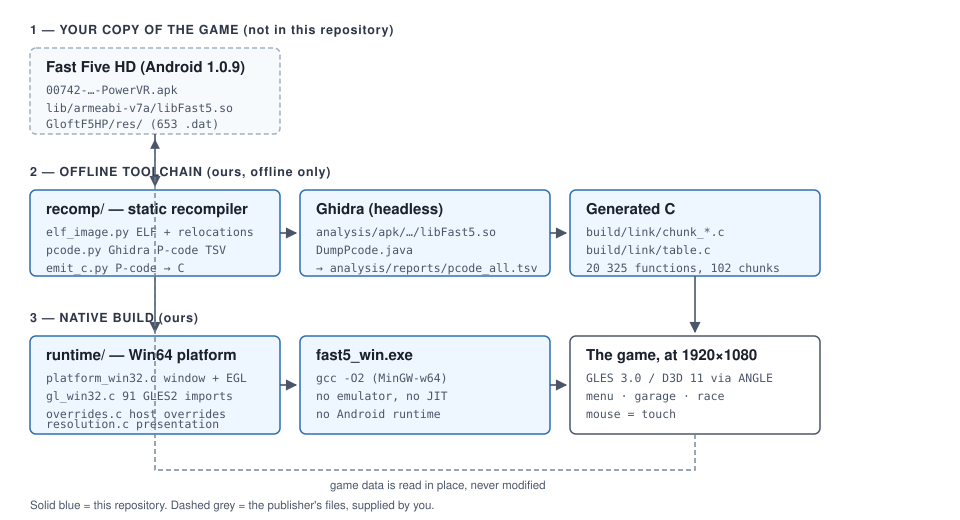

# Fast Five HD — Native PC Port (toolchain & platform layer)

A **clean-room static recompilation** of the ARMv7 Android build of *Fast Five HD* into native
x86-64 Windows C — **no emulator, no ARM interpreter, no JIT, no Android runtime** in the shipped
binary.

This repository contains the **porting toolchain and the native platform layer**. It does **not**
contain the game: no APK, no native library, no game data, no screenshots. See
[`NOTICE.md`](NOTICE.md) for the full legal position and [`SETUP.md`](SETUP.md) for how to supply
your own copy and build.



---

## What this is

The shipped Android library is a 8.4 MB ARMv7-A ELF (VFPv3, softfp, GCC 4.4) containing an
Irrlicht-derived engine (*Glitch*), a particle system (*Spark*), an audio engine (*Vox*) and the
whole *Fast Five* game — roughly 20 000 functions of C++.

Hand-reimplementing that is not 1:1, so instead the **machine code is translated ahead of time**:

```
ARMv7 instructions ──► P-code ──► portable C ──► native x86-64 ──► game
   (Ghidra)            (ours)      (ours)         (gcc)          (ours)
```

The game's own code is preserved — its memory layout, its data, its control flow, its floats, its
C++ exceptions.  Only the *platform* underneath it is replaced: a window instead of a
`GLSurfaceView`, GLES2 instead of `libGLESv2.so`, Win32 threads instead of pthreads, a real
filesystem instead of `/sdcard`.

That is the difference between this and an emulator: there is no guest architecture at run time.
The game is C, running at native speed on the host CPU.

## Status

| Milestone | State |
|---|---|
| Target dossier, engine identification, data model | ✅ done ([docs/01](docs/01-TARGET.md), [docs/02](docs/02-ARCHITECTURE.md)) |
| Static recompiler — 20 325 / 20 325 functions emitted | ✅ done ([recomp/](recomp/)) |
| Native Win64 platform layer — window, GLES2, threads, FS, JNI | ✅ done ([runtime/](runtime/)) |
| Boot → title → main menu | ✅ done |
| Garage, car select, track select | ✅ done |
| Full race (player car, opponents, HUD, minimap, cinematic) | ✅ done |
| Race → debrief → menu → race, repeated, save preserved | ✅ done |
| Full HD presentation (native 1080p engine + scaled 2D layer) | ✅ done (M6.5) |
| Live window resize | ⬜ open — the EGL surface is created once at start-up |
| Quantified 1:1 validation against a reference device | ⬜ open (M7) |

The game currently runs at **1920×1080 with a native 1080p 3D scene**, the 2D layer scaled from
the game's own authored 800×480 space, mouse input mapped to the game's touch events, and **zero
guest faults** in a full boot → menu → race → debrief cycle.

## How the resolution work is done

This is the most interesting engineering problem in the port, and it is worth a paragraph.

The game lays its 2D layer out on a **fixed 800×480 canvas** — menus, HUD anchors, licence text,
loading widgets — regardless of the screen it is given.  The engine owns its screen-size globals
and rewrites them: `Application::Init` computes a *logical* size from the screen it was handed,
and the application is **destroyed and re-created during boot**, which reset that logical size and
threw the 2D layout outside the window.

The engine also has what looks like a resolution-independence mechanism (an *application scale*
at `Application+600`, and HUD anchors that are ratios of `SCR_WIDTH`/`SCR_HEIGHT`).  It is only
half of one: the scale moves **positions**, not the artwork, and the bitmap font never grows at
all — so the 2D *screens* (the Universal logo) stay where they were authored and end up in the
corner of a large screen.  The port therefore keeps the guest's canvas and converts it itself:

| Layer | Runs in | Space |
|---|---|---|
| Device, render targets, camera, scene | guest | the **window** size (native 1080p) |
| 2D layout, hit rectangles, HUD anchors | guest | the game's authored **800×480** |
| 2D draws, pointer, 3D picking | host | one shared affine transform |

One transform (`runtime/resolution.c`) is shared by every consumer — the 2D draw, the pointer,
the 3D pick, the camera aspect — so they cannot drift apart.  The canvas is 5:3 and the window
usually is not, so `FAST5_UI_FIT` picks what gives: `fill` (the default) lets the canvas cover
the window, `crop` covers it without distorting it but clips the canvas's top and bottom, and
`letterbox` keeps the proportions and centres the canvas.  Change the window size and the whole
layer follows — that is the *global resolution changer*.

Getting there required finding several separate traps, each documented in
[`docs/05-STATE.md`](docs/05-STATE.md):

* the engine's 2D **clip rect** is persistent state and has to be scaled for the duration of a
  draw and restored afterwards, or every scaled draw is culled away;
* the `draw2DRectangle` override bypassed the shared transform and scaled each axis on its own,
  so the fit mode had no effect and the 2D was stretched by 6.7 % at 1080p;
* the soft-float ABI passes a float in a **core register**, not in `s0`;
* the capture tool was writing every frame **upside down**, so the screenshots used to verify the
  work were mirrored.

## Repository layout

```
recomp/          the static recompiler
  elf_image.py     ELF32 loader: segments, 62 432 relocations, symbols, .init_array
  pcode.py         parser for the Ghidra P-code TSV
  emit_c.py        P-code -> C instruction state machine
  link_all.py      emits every function into chunks + the global address table
  diff_test.py     differential test: translated C vs the original ARM under Unicorn
  coverage.py      emitter coverage report over the whole P-code dump
  ghidra_scripts/  headless Ghidra scripts that dump the P-code

runtime/         the native Win64 platform layer
  platform_win32.c  window, message pump, input, ANGLE/EGL loading
  gl_win32.c        all 91 GLES2 imports over desktop GL
  overrides.c       host overrides for individual guest functions
  resolution.c      the presentation transform (design space <-> window)
  thread_win32.c    the pthread subset over Win32
  vfs.c             guest path -> local data tree (read-only)
  java_bridge.c     the JNI surface the game actually touches
  imports.c         the 300 PLT imports
  main_win32.c      the harness: constructors, appInit/appRender, capture

tools/           build and diagnostic scripts
docs/            the engineering documentation
analysis/        census reports and small analysis helpers
third_party/     how to supply ANGLE (the binaries are not redistributed)
```

## Documentation

| Document | What it is |
|---|---|
| [docs/00-RULES.md](docs/00-RULES.md) | The operating contract for every session |
| [docs/01-TARGET.md](docs/01-TARGET.md) | What is being ported: hashes, inventory, ABI, data model |
| [docs/02-ARCHITECTURE.md](docs/02-ARCHITECTURE.md) | How the shipped game is built, subsystem by subsystem |
| [docs/03-STRATEGY.md](docs/03-STRATEGY.md) | Why static recompilation, and what it costs |
| [docs/04-ROADMAP.md](docs/04-ROADMAP.md) | Milestones M0–M8 with their acceptance gates |
| [docs/05-STATE.md](docs/05-STATE.md) | **Live state — the current handoff** |
| [docs/06-EVIDENCE.md](docs/06-EVIDENCE.md) | Evidence ledger: every claim tied to a tool record |
| [runtime/README.md](runtime/README.md) | The platform layer, module by module |
| [recomp/README.md](recomp/README.md) | The recompiler, module by module |
| [tools/README.md](tools/README.md) | The scripts, and what each one proves |

The documentation is written to be useful to somebody who has never seen this project: what was
measured, how it was measured, and what is still open.

## Building

You need **your own copy** of the game. See [`SETUP.md`](SETUP.md) for the full walkthrough.

```bash
# 1. supply the game  (APK + data tree, see SETUP.md)
# 2. build the relocated guest image from the native library
python tools/patch_guest.py
# 3. dump the P-code from the native library with headless Ghidra
bash tools/dump_pcode.sh
# 4. emit the C translation units
python recomp/link_all.py analysis/reports/pcode_all.tsv --emit-only
# 5. compile and link the native Windows build
python tools/build_win.py
# 6. play
./play.bat            # or: play.bat menu   /   play.bat race
```

Requirements: Python 3.9+, MinGW-w64 GCC (x86-64), and Ghidra for step 2.  The build is
incremental; `--force` rebuilds everything (and takes a few minutes).

## Running

The port reads the game data **in place** and never writes to it.  It creates its writable data in
`build/userdata/` and serves derived assets from `build/overlay/`.

| Variable | Default | Effect |
|---|---|---|
| `FAST5_WIDTH` / `FAST5_HEIGHT` | `1920` / `1080` | the presentation size of the window |
| `FAST5_UI_FIT` | `fill` | `crop` fits the canvas undistorted and covers the window (clipping the canvas's top and bottom); `letterbox` keeps the proportions and centres the canvas |
| `FAST5_ENGINE_RES` | `native` | `design` runs the engine at 800×480 instead of the window size |
| `FAST5_UI_2D` | `design` | `native` lets the engine lay the 2D layer out for the window (see below) |
| `FAST5_WINDOWED` | off | force a framed window instead of borderless |
| `FAST5_FAKE_GPU` | off | report the PowerVR identity the game expects |
| `FAST5_AUTO_MENU` | off | drive the title screen into the main menu |
| `FAST5_AUTO_RACE` | off | drive all the way into a race |
| `FAST5_CAPTURE` | off | write frame captures to `build/` |
| `FAST5_GL_TRACE` | off | log every GL call |
| `FAST5_LOG` | — | write the session log to a file |

Controls: **mouse** = touch; **arrow keys** = tilt/steer; **Enter / Space** = touch at the screen
centre; **Alt+F4** = quit.

## Contributing

The project follows two rules that are worth stating up front, because they are what make the
result trustworthy:

1. **No guesses.** Every claim about the target is backed by a tool record, and the record is
   cited.  An unresolved question is written down as an unknown, not guessed at.
2. **1:1 means 1:1.** The port reproduces the Android build's behaviour — the same data bytes,
   the same loaders, the same simulation, the same save format.  "It boots" is not done.

The differential test (`recomp/diff_test.py`) is the gate that keeps the translator honest: it runs
a translated function and the original ARM code on identical state and compares the results.

## Licence

The toolchain and platform layer are MIT licensed — see [`LICENSE`](LICENSE).  The game is not
part of this repository; see [`NOTICE.md`](NOTICE.md).

Third-party components are used offline or linked, never redistributed: Ghidra (analysis),
ANGLE (GLES2 backend), MinGW-w64 (host compiler).
